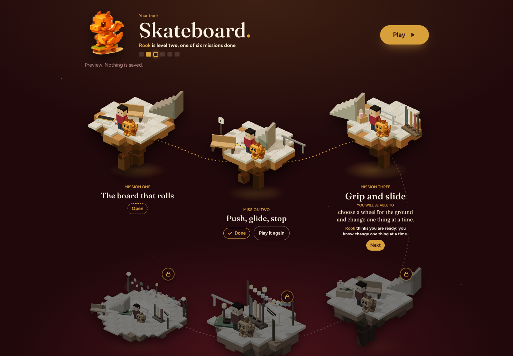
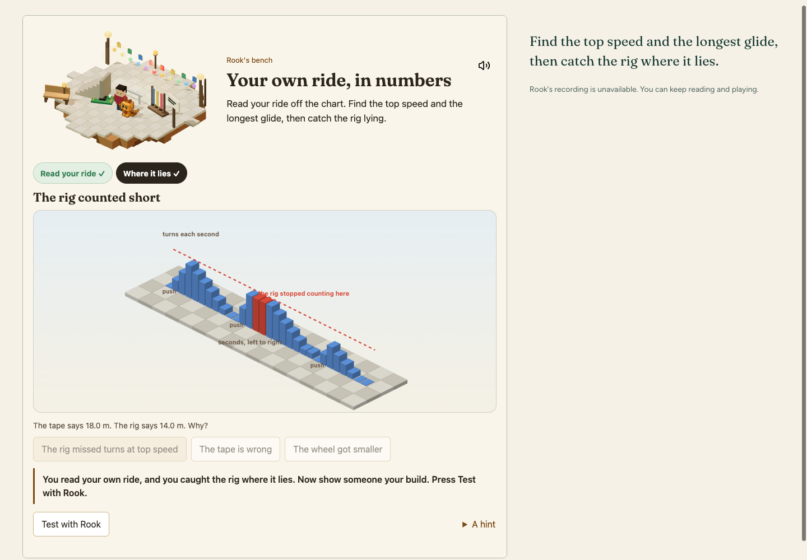
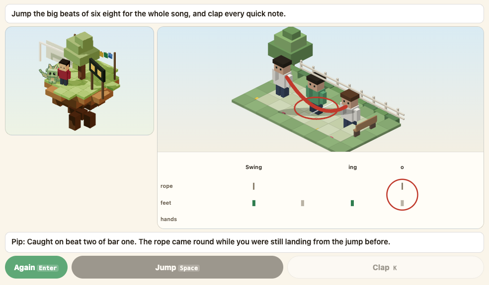
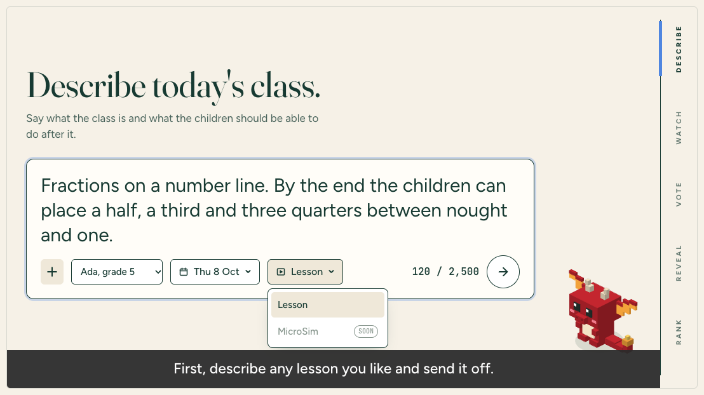
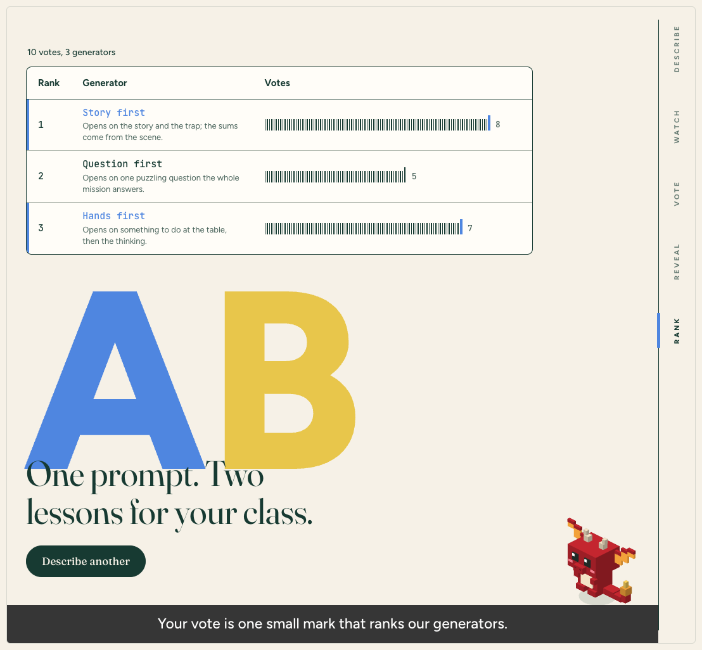
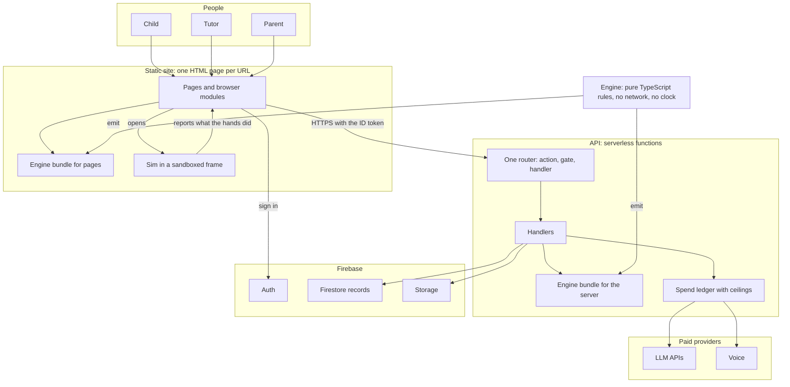
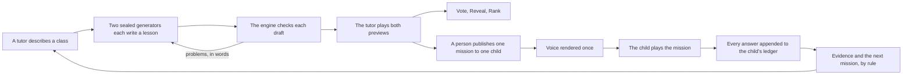

# Nell & Key: how it is built and measured

[Nell & Key](https://www.nellandkey.com) is a learning product for children in grades 1 to 7. A child follows a road of missions built around something they love. Each mission sits on a small voxel island and holds a simulation that reports what the child actually did. A tutor stays in the loop: a model may draft a mission, but nothing reaches a child until a person publishes it.

This repository is a case study: how the product is built, and how its LLM parts are measured. It holds prose, diagrams and screenshots. The product code is private.

**My role.** I am the founder. AI coding agents write most of the code under my direction; I own the architecture, the evals, the gates and every release decision.

## Where it stands (2026-10-01)

- Live at nellandkey.com. Roads: Spanish, Websites and Skateboard with six missions each, Trumpet with three of six, and two more, one of them for children who cannot read yet.
- Nell, the lesson writer behind Mission Arena, had not yet finished a lesson in production: five of six arena sides stopped at a 30 second provider timeout. Fixing that is the current work.
- The mission writer's eval numbers below come from a stand in model and must be rerun on the production model.
- The knowledge model that opens each mission runs on constants not yet fitted to real answers, so its "ready" is advice to the tutor, not a measurement.

## Screens

A road. Each mission is its own island. Mission three is open because the engine believes the child knows what it needs; four to six stay locked. A preview page, captured by a scripted walk.

A mission's sim: the child reads their own ride off a chart and catches the counting rig where it lies. The sim reports what the child did, not only right or wrong.

A rhythm sim names the exact mistake: "Caught on beat two of bar one."

Mission Arena, step one: a tutor describes the class. "Ada, grade 5" is a test fixture, not a child.

The arena's board after a scripted walk with stub generators. Test data, not real votes.

## The system

The shape the code is moving to under a written consolidation plan, redrawn from the repository's architecture document. Most of it runs today; where it does not yet, the bullets below say so.

- The engine holds the product's rules (what a mission is, what counts as done, what comes next) and is emitted into two bundles, so a page and the API cannot disagree about a rule.
- The API is one router. Today each handler decides who may call it; one gate table in the router, with a test that fails for any action without a gate, is planned work. Browsers read and write almost nothing in the database directly.
- Mission drafts, model turns and voice are called only by the API, after the spend ledger checks the ceilings.
- A change reaches production one way: the central session runs the gate and puts the change on main, where worker branches arrive as merges; CI runs the gate again on every push; the host builds only the project whose folder changed; and a release is verified by asking the API which commit it runs. Requiring a pull request for every change to main comes with the move to a GitHub organization.

## From a prompt to a child

A preview saves nothing and renders no voice, because a draft must not cost money.

## Engineering practices, with numbers

### 1. An eval before trusting the writer

- **Gold.** 15 hand built missions (Trumpet one to three, Spanish and Websites one to six), each turned into a blueprint without its words; the writer drafts each one again.
- **Graders.** The 17 rules of the lesson spec as checks, plus the engine's own validator. Two rules are not graded on a document: one is the blueprint's choice, and only a browser walk can pass the other. A draft passes when the engine accepts it and no rule fails.
- **Calibrate first.** The graders ran on the gold before any draft. 8 of the 15 gold missions failed, every one the grader's fault. After the fixes all 15 pass, and a test holds it.
- **Copy check.** The share of a draft's sentences taken from its own gold. Over 30 percent fails the draft.
- **The leak.** Batched runs gave each stand in five prompts, so a stand in that had read a target's gold as an example wrote it back. Those runs copied 47 and 57 percent and were thrown out; every run with examples was redone one prompt per stand in.
- **What moved the pass rate.** Saying what one field means: 0 to 11 of 15. An ablation without examples passed 13 of 15, because drafts copied the examples' structure. Handing over the beats as a skeleton: 15 of 15. Examples shown as words only: still 15 of 15, with copying down to 1 percent.
- **Limits, stated in the eval.** A stand in model (Claude Haiku) made every draft. At 15 of 15 the graders have no headroom left. They read structure, not whether a mission teaches well; that needs a critics' panel or a person playing it.
- **Cost.** A production draft is one call (a retry only if it fails), capped at 12 cents by default.

### 2. Votes from the people who know the class

- Mission Arena runs five steps in a fixed order: Describe, Watch, Vote, Reveal, Rank. Two of three generators (Story first, Hands first, Question first) each write a lesson from one prompt of up to 2,500 characters. The pair, and which one sits in seat A, both come from a hash of the arena's id, so seat bias can be measured later.
- The names stay sealed until the vote, enforced in the engine, not the page: until a vote is stored, the view a desk receives carries no generator name, whatever the caller asks.
- Four votes: A is better, B is better, both good, both bad. A generator's score is wins plus half its "both good" votes, over games. No vote is ever thrown away.
- Next: a Bradley-Terry model with ties and a position bias check, since points over games ignores who a generator played against.
- Votes are adult judgments, and the only training signal: children's data trains nothing, and parents own it.
- Proof: mutants caught 27 of 27 in the engine, 36 of 36 in the server, 21 of 21 in the drafter. Walks: the arena page 122 checks, the arena against the Firebase emulators 44, the dragon mascot 42.

### 3. Tests that have been seen to fail

- The prover's rule: "A test that has never been seen to fail is a rumour." An earlier gate in this repository shipped 341 passing tests over a broken random seed, because not one of them touched the seed.
- A mutant is a literal find and replace in the source, plus what should break. The prover applies one, runs the suite, expects red, then restores the file. Literal strings, not patterns: a pattern that matches a comment reports a pass.
- 346 mutants in 25 lists guard the learning product (406 in 31 lists across the repository, which still holds an older voxel game).
- vitest: 2,461 tests at the arena merge on 2026-10-01, 2,432 just before it. Both counts include the older game's tests.
- Firestore rules: 320 cases against the emulator, including every way around the rules a reviewer tried. Storage rules: 10 cases, each also shown to be allowed by the rules they replaced, so no case passes for the wrong reason.

### 4. Browser walks with real presses

- Done means a browser walked it with real presses. A walk drives Chrome over the DevTools Protocol and checks what the page shows.
- One harness, because the same browser bootstrap had been written fifteen times in a single day, and one copy aimed a key at the wrong element and reported a pass.
- The gate knows the count each walk must print. Raise it in the commit that adds checks; never lower it to pass.
- The Skateboard road: all six missions to their close at 390, 820 and 1440 pixels, with real presses and arrow keys on the sliders: 262 checks, 0 failed. Its six tests are proved by 12 mutants, all caught.
- Others the gate compares: tracks 316 checks, the founder desk against the Firebase emulators 222 (209 earlier that day, before the Nell tab), the starter shelf 67, the rope yard sim 66.

### 5. Working with coding agents

- One task, one branch, one pull request. Workers never merge, never deploy and never call a paid provider unless the brief says so. One central session reviews, merges and releases.
- One gate, the same command in CI, in under a minute: types, API types held to a baseline that may only shrink, vitest, fresh bundles, validators, lint held to a baseline, and no dash or secret added.
- A problem log, "Problems we have already paid for": symptom, cause, fix and a one minute check, read before debugging.
- Numbers get checked against files. In one founder note, 15 of 82 claims were wrong until three skeptic reviewers checked them. Every number here cites its file in the private repository, in a comment at the end of this README's source.
- A pre-push hook refuses a commit the host would silently block, after four blocked deployments piled up unseen on 2026-09-10. It was verified by sabotage.
- Repoint before delete: the same day, a deploy target was deleted before it was repointed, and a successful build of nothing replaced a working API.

### 6. Cost and privacy as rules in code

- Mission drafts, model turns and voice renders pass the spend ledger: 12 cents per mission draft, 10 dollars per family per month for model calls and 10 for ElevenLabs voice, 25 dollars per month for the platform (defaults).
- Voice is rendered once, after publish, never for a draft: about 20 cents a mission.
- One price table by model, with its source and date, after prices typed in three places billed a model at about a third of its price, so every ceiling admitted about three times what it said.
- The privacy page is a rule for the data pipeline: "we do not train any model on their words, their drawings or their pages".
- A tutor's arena prompt is refused if it carries a way to reach a person, because it goes to a provider and is kept for training.

## What I learned

- Calibrate the grader before grading. More than half the gold failed the first graders.
- Look for leakage in your own method. Batched prompts leaked targets into drafts that were supposed to be blind.
- Quote the unit with the number. "121 story moments" turned out to be 121 walk checks; the road has seventeen moments.
- A test that never failed proves little, and a walk that finds a box without reading its words proves less. On screens under 900 pixels the mission labels were empty boxes; now the walk reads the words.
- Kill the process group, not the wrapper. Walks that stopped only `npx` left about eight hundred server processes and twenty nine gigabytes of swap behind.
- Agents multiply output, not judgment. The evals, the gates and the release call stay with a person.

## What is not here

- No product code, prompts, keys or configuration.
- No child's, parent's or tutor's name or data. Screenshots come from preview pages and scripted walks with fixtures.

## License

Text and diagrams: CC BY 4.0. Screenshots: all rights reserved.

<!--
Sources for every number, in the private product repository at commit ce2f38e71 (main, 2026-10-01).
Status: docs/STATE.md:14-17 (roads), :55-58 (Nell, the 30 second timeout), docs/engineering/PROBLEMS.md:70 (constants not fitted).
Eval: docs/engineering/lesson-gen/ROAD_WRITER_EVAL.md:10-13 (15 gold), :14-18 (17 rules), :19-21 (30 percent copy check), :22-25 (8 of 15 gold failed), :29-36 (stand in Claude Haiku, rerun), :45-46 (57 and 47 percent, discarded), :47 (11 of 15), :48 (13 of 15 without examples), :49-50 (15 of 15, 1 percent), :80-82 (0 to 11), :96-104 (the leak), :106-115 (what graders cannot see), :121-123 (12 cents).
Arena: packages/primer/src/arena.ts:5 (five steps), :16 (2,500 characters), :19 (four votes), :34-49 (three generators), :63-72 (pair and seat from a hash of the id), :79-81 (a prompt with an address, phone number or link is refused; prompts are kept for training), :205-208 and :230 (score, no vote thrown away), :278-280 (sealed until the vote); docs/engineering/CONSOLIDATION_PLAN.md:1227-1231 (adults first, opt in); docs/archive/handoffs/2026-09-handoff-log.md:58-59 (27, 36, 21 mutants caught), matching the entries in docs/engineering/arena-mutants.json (27), arena-server-mutants.json (36) and ask-draft-mutants.json (21); scripts/walks.json:55, :62, :72 (122, 42, 44).
Mutants: scripts/prove.mjs:5-6 (rumour), :8-9 (341 tests), :18-20 (literal strings). 346 in 25 lists and 406 in 31: git ls-files | grep -E 'mutants.*\.json$' | grep -v -E '^(agent_work|apps|tools)/' gives 31 lists and 406 entries; the 6 lists whose targets sit in packages/simulation, packages/world-content, packages/press or apps (the voxel game) hold 60.
vitest: docs/archive/handoffs/2026-09-handoff-log.md:58 (2,461; 2,432 before), docs/archive/2026-10-01-audit/engine-scripts-docs.md:42 (2,432 in 139 files); vitest.config.ts:28 (includes packages, apps and webhook/lib).
Rules: docs/STATE.md:93-95 (320 and 10 cases); firebase/rules-attacks.mjs:1-7 (the reviewer's attempts, used by rules-cases.mjs).
Walks: docs/STATE.md:138 (done means walked); scripts/walk.mjs:4-7 (fifteen times); scripts/walks.json note (raise, never lower); docs/archive/handoffs/2026-09-handoff-log.md:150-155 (Skateboard: six tests, 12 mutants, 390, 820 and 1440 pixels, 262 checks, 0 failed); scripts/walk-skateboard-road.mjs:225 (the three widths); docs/engineering/skateboard-road-mutants.json (12 entries); scripts/walks.json:15, :24, :31, :48 (316, 67, 66, 222); docs/STATE.md:100 (222); commit 5c15908d6 (222 after the Nell tab); docs/START_HERE.md:87 and docs/engineering/CONSOLIDATION_PLAN.md:243 (209 earlier).
Agents: AGENTS.md:9-12 (one task, one branch); docs/STATE.md:85-90 (the gate); docs/engineering/PROBLEMS.md:1-9 (the log), :96 (15 of 82), :46 (121 checks, seventeen moments), :55 (build of nothing), :33 (eight hundred processes, 29 GB swap); .githooks/pre-push:6 (four blocked deployments), :39-40 (sabotage); docs/archive/handoffs/2026-09-handoff-log.md:534-537 (empty label boxes).
Cost and privacy: docs/engineering/COST_POLICY.md:55-60 (10, 10, 25 dollars, 12 cents); docs/STATE.md:25-26 and docs/engineering/PROBLEMS.md:91 (20 cents a mission); docs/engineering/PROBLEMS.md:76 (one price table, a third of the price); site/privacy.html:98-100 (no training on a child's work); docs/ARCHITECTURE.md:181-182 (a preview saves nothing).
Diagrams: redrawn from docs/ARCHITECTURE.md sections 1 and 2 with generic labels. Section 1 is the shape after the consolidation (ARCHITECTURE.md:3-6). Today: webhook/api/app-actions.ts maps an action name straight to its handler; the gate table is CONSOLIDATION_PLAN.md wave 5 (:722, :726-731); 131 of the 139 first-parent commits on main from 2026-09-25 to 2026-10-01 were direct commits, 8 were merges. Ledger scope: COST_POLICY.md:50-62 (the meters; Azure has no per family ceiling), docs/engineering/lesson-gen/ROAD_WRITER_EVAL.md:29-30 (drafts through model.ts); tests: vitest.config.ts:27 (a scripted model on the loopback). Walks are not yet barred from paid providers (COST_POLICY.md:134-140), so no claim about walks is made. Rules R5 and R16 not graded: ROAD_WRITER_EVAL.md:16-18. A retry only if it fails: ROAD_WRITER_EVAL.md:121-123.
Screenshots: agent_work/primer/skateboard-road/1440-road.png, 1440-m6-data.png; agent_work/sims/rope-yard/desktop-compound-trap.png (cropped); agent_work/primer/arena/1440-describe-menu.png, 1440-rank.png. "Ada" is the fixture fixture-ada: scripts/walk-arena-ui.mjs:147, site/primer/arena-fixture.html:54.
-->
